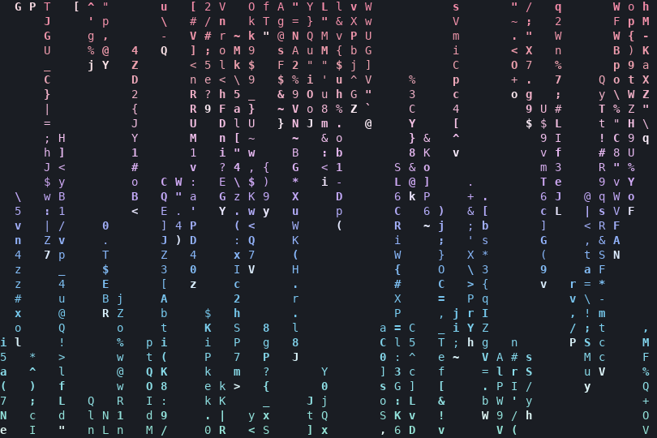

# cmatrix-cava

Lluvia estilo [cmatrix](https://github.com/abishekvashok/cmatrix) que usa el degradado de colores de tu configuración de [cava](https://github.com/karlstav/cava).

El cmatrix original solo admite un color. Este script pinta cada fila con el degradado de cava, igual que las barras: abajo `gradient_color_1` y arriba el último color.



## Requisitos

- Python 3 (solo librería estándar)
- Una terminal con soporte de color de 24 bits (Konsole, kitty, Alacritty, etc.)
- Opcional: cava con `gradient = 1` y sus `gradient_color_N` en `~/.config/cava/config`. Si no existe, usa un degradado Catppuccin por defecto.

## Instalación

```sh
git clone https://github.com/AmiyaMihari/cmatrix-cava.git
cp cmatrix-cava/cmatrix-cava ~/.local/bin/
```

Para que `cmatrix` abra esta versión en fish:

```sh
cp cmatrix-cava/fish/cmatrix.fish ~/.config/fish/functions/
```

El cmatrix original sigue disponible con `command cmatrix`.

## Uso

```sh
cmatrix-cava        # o cmatrix, si instalaste la función de fish
cmatrix-cava -u 6   # más lento (0-10, igual que cmatrix; default 4)
```

Sal con `q`, `Esc` o `Ctrl+C`.

Los colores se leen cada vez que lo abres, así que si cambias el degradado de cava la lluvia cambia también.
